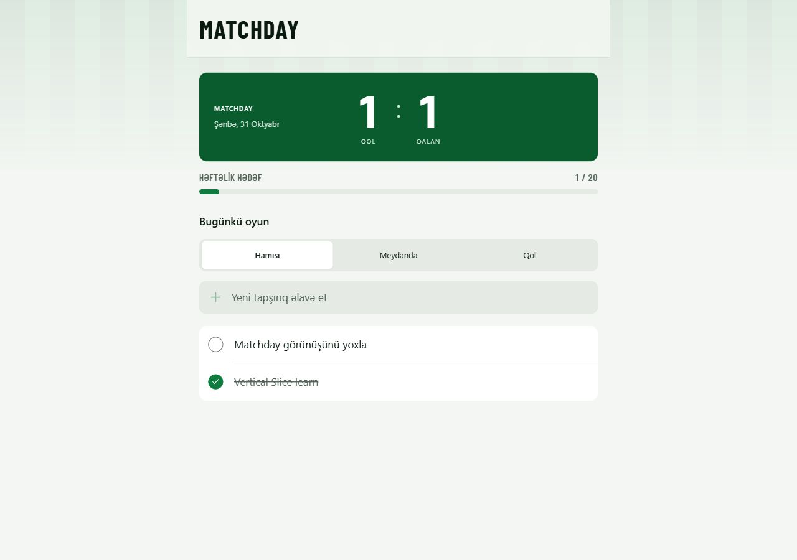
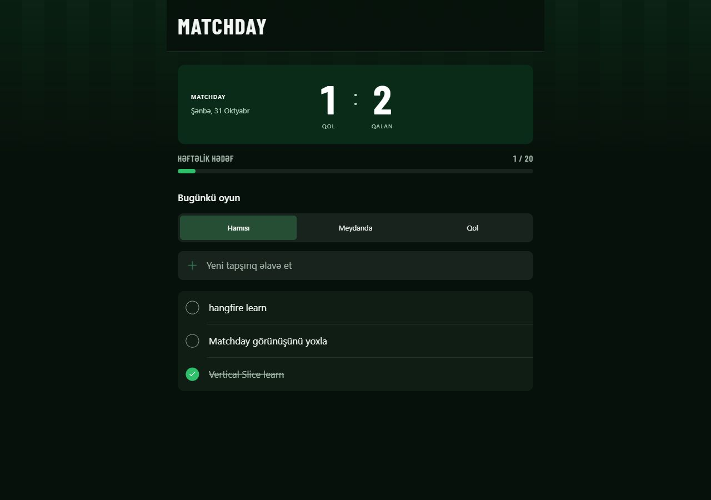

# Matchday — tapşırıq oyunun

Gündəlik tapşırıqları əlavə etmək, redaktə etmək və tamamlamaq üçün sadə TODO tətbiqi.
React interfeysi və .NET backend-i eyni repozitoriyadadır. Layihə Vertical Slice və Hangfire-i oxunaqlı nümunələrlə öyrənmək üçün hazırlanıb.


## Xüsusiyyətlər

- Tapşırıq yaratmaq, başlığını dəyişmək, tamamlamaq, geri aktiv etmək və silmək.
- Hamısı / Aktiv / Tamamlanmış filtrləri və qalan aktiv tapşırıqların sayı.
- Azərbaycan dilində mobil uyğun interfeys, yüklənmə, boş siyahı və xəta vəziyyətləri.
- Başlıq üçün boş olmama və maksimum 200 simvol qaydası.
- SQL Server və EF Core Code First migration-ları ilə daimi məlumat.
- Yeni tapşırıq üçün Hangfire konsol bildirişi; hər saat köhnə tamamlanmış işlərin təmizlənməsi.
- Development mühitində Swagger və Hangfire dashboard.

## Arxitektura

Vertical Slice funksiyanın endpoint-ini, sorğu modelini və məntiqini bir yerdə saxlayır.
Hər feature bir statik qabıq sinif, Request record, Handler və MapEndpoint metodundan ibarətdir.
Handler DI, yəni asılılıqların avtomatik verilməsi ilə yaradılır. Job feature-lərinin MapEndpoint metodu HTTP ünvanı açmır; eyni şablonu qoruyur.
MediatR, AutoMapper və FluentValidation istifadə olunmur.

## Qovluq strukturu

```text
backend/
  .config/dotnet-tools.json
  requests.http
  src/TodoApi/
    Common/             # Todo və AppDbContext
    Composition/        # AddTodoFeatures ilə handler qeydiyyatları
    Features/Todos/     # Get, Create, Update, Toggle, Delete
    Features/Jobs/      # Bildiriş və təmizləmə
    Migrations/         # Code First baza dəyişiklikləri
    Program.cs          # Qoşulmalar və job planı
frontend/
  .env.example
  src/api/              # fetch sorğuları
  src/components/       # Forma, siyahı, element və filtrlər
  src/types/            # Todo və TodoFilter
  src/App.tsx
  src/App.css
docs/                   # Təlimatlar və əvvəlki demonun arxivi
.github/workflows/ci.yml
```

## Necə işə salmaq

**Tələblər:** .NET 8 SDK və runtime (daha yeni SDK da build edə bilər), Node.js 22.12+ və npm, yerli SQL Server. SQL Server Express də istifadə oluna bilər; ayrıca quraşdırılmış server lazımdır. Bu versiyada SQLite yoxdur.

### Backend

Yerli ayarda server `Revan`, baza `TodoDb`, giriş **Windows Authentication** olaraq nəzərdə tutulub.
`backend/src/TodoApi/appsettings.json` faylındakı ConnectionStrings:TodoDatabase dəyəri:

```text
Server=Revan;Database=TodoDb;Trusted_Connection=True;TrustServerCertificate=True
```

Bu ayar yalnız yerli inkişaf üçündür. TrustServerCertificate yerli sertifikata etibar edir; real yayımlamada sertifikatı düzgün qurun.
İşlədən Windows istifadəçisinin serverdə giriş və ilk açılışda baza yaratmaq icazəsi olmalıdır.
Başqa server üçün həmin ayarı dəyişin və ya `ConnectionStrings__TodoDatabase` mühit dəyişənini verin. Parolu Git-ə yazmayın.

Kök qovluqda:

```sh
dotnet build backend/src/TodoApi/TodoApi.csproj
dotnet run --project backend/src/TodoApi --launch-profile http
```

Tətbiq açılarkən `MigrateAsync()` migration-ları tətbiq edir; baza yoxdursa yaradır. Əvvəlcədən mövcud eyniadlı baza varsa, tətbiqdən əvvəl quruluşunun uyğunluğunu yoxlayın.
API: [localhost:5000/api/todos](http://localhost:5000/api/todos)
Swagger: [localhost:5000/swagger](http://localhost:5000/swagger)

Yeni model dəyişikliklərindən sonra, backend qovluğunda:

```sh
dotnet tool restore
dotnet ef migrations add DescribeYourChange --project src/TodoApi
```

Sonra tətbiqi yenidən başladın. `EnsureCreated` istifadə edilmir; sxem migration-larla idarə olunur.

### Frontend

Ayrı terminalda:

```sh
cd frontend
npm install
```

`.env.example` faylını `.env` adı ilə köçürün (PowerShell: `Copy-Item .env.example .env`; Bash: `cp .env.example .env`). Dəyər: `VITE_API_URL=http://localhost:5000`.

```sh
npm run dev
```

İnterfeys: [localhost:5173](http://localhost:5173). Ünvan ayarını dəyişəndən sonra Vite-i yenidən başladın.
Backend CORS origin-i appsettings.json-dakı `FrontendOrigin` dəyərindən oxuyur: `http://localhost:5173`.

## API endpoint-ləri

| Metod | URL | Təsvir |
| --- | --- | --- |
| GET | /api/todos?filter=all | Bütün tapşırıqlar; active və completed də qəbul edilir. |
| POST | /api/todos | JSON: {"title":"Kitab oxu"}; 201 qaytarır. |
| PUT | /api/todos/{id} | JSON ilə yalnız başlığı yeniləyir; 200 qaytarır. |
| PATCH | /api/todos/{id}/toggle | Tamamlanmanı dəyişir; 200 qaytarır. |
| DELETE | /api/todos/{id} | Silir; 204 qaytarır. |

Boş və 200 simvoldan uzun başlıq üçün 400, tapılmayan düzgün Guid ID üçün 404 qaytarılır.
Nümunə sorğular: [backend/requests.http](backend/requests.http).

## Hangfire dashboard

Yalnız Development mühitində: [localhost:5000/hangfire](http://localhost:5000/hangfire).
Xüsusi giriş nəzarəti yoxdur; bu, yerli demodur. Swagger də yalnız Development-də açılır.
Yeni tapşırıq işi yalnız ID alır və `Yeni tapşırıq yaradıldı: ...` yazır.
`cleanup-completed-todos` hər saatın başlanğıcında, UTC cədvəli ilə planlanır; tamamlanma tarixi 7 gündən köhnə olan tapşırıqları silir. Tətbiq açıq olmalıdır; ilk işi dərhal gözləməyin.
Hangfire.InMemory növbə və tarixçəni restart zamanı itirir. SQL Server-dəki todo-lar isə qalır.
Əlavə retry ayarı yoxdur; standart Hangfire retry davranışı qalır.

## Build və yoxlama

```sh
dotnet build backend/src/TodoApi/TodoApi.csproj
cd frontend
npm ci
npm run build
```

Əl ilə ssenari: tapşırıq yaradın, redaktə edin, tamamlayın, filtrləri dəyişin, geri aktiv edin və silin.
Səhifəni yeniləyəndə saxlanmış işlər qalmalıdır. Backend dayananda Azərbaycan dilində xəta mesajı görünməlidir.
CI build yoxlayır; SQL Server tələb edən işləmə yoxlaması CI-a daxil deyil.

## Ekran görüntüsü

| Light | Dark |
| --- | --- |
|  |  |

Yeni ekran görüntüsü çəkərkən eyni görünüşü light və dark sistem rejimlərində saxlayın:
`docs/screenshot-light.png` və `docs/screenshot-dark.png`.
Hər rejimdə 375px mobil və 1280px desktop görünüşünü yoxlamaq tövsiyə olunur.
Əvvəlki `docs/screenshot.jpg` köhnə dizayna aiddir.

## Dizayn konsepti

Matchday gündəlik tapşırıqları bir oyun kimi təqdim edir: aktiv işlər meydandadır, tamamlananlar qoldur.
Yaşıl vurğu və yuxarıdakı incə meydan zolaqları futbol hissi yaradır; mövcud təmiz siyahı və klaviatura dəstəyi saxlanılır.
Lokal Barlow Condensed yalnız Matchday başlığında, hesab rəqəmlərində, QOL yazısında və həftəlik hədəf etiketində istifadə olunur.
Klub və liqa loqosu, avtomatik səs, animasiya və konfeti kitabxanası yoxdur; sistemin azaldılmış hərəkət seçimində effektlər sönür.

Rəng və ölçülər `frontend/src/styles/tokens.css`, komponent stilləri `frontend/src/App.css` faylındadır.
Həftəlik hədəf `frontend/src/constants.ts` daxilində 20-dir; bazar ertəsindən indiyədək tamamlanan və hələ tamamlanmış vəziyyətdə olan tapşırıqlar sayılır.
Hesab tablosu tarix etiketinə baxmayaraq bütün mövcud tapşırıqları sayır; gündəlik tarix filtri tətbiq etmir.
Həftəlik göstərici serverin qaytardığı mövcud məlumatdan hesablanır; silinmiş tapşırıqlar ayrıca tarixçə kimi saxlanmır.

## Əlavə sənədlər və oxuma ardıcıllığı

- [Layihə icmalı](docs/01-layihe-icmali.md)
- [Texniki qərarlar](docs/02-qerarlar.md)
- [Sonra öyrəniləcək mövzular](docs/03-sonra-arasdirilacaq-movzular.md)
- [Yeni feature və lüğət](docs/04-yeni-feature-elave-etme-ve-lugət.md)
- [Əvvəlki sifariş demosu](docs/archive/orders-demo/README.md) — əvvəlki kod və sənədlər ayrıca qorunub.

Kodu belə oxuyun: Todo → AppDbContext → GetTodos → CreateTodo → TodoCreatedNotification → UpdateTodo / ToggleTodo / DeleteTodo → CleanupCompletedTodos → Program.cs → frontend/types → api → komponentlər → App.tsx.

## Gələcək planlar

- İstifadəçi girişi və hər istifadəçiyə ayrıca tapşırıqlar.
- Avtomatik unit və integration testlər.
- Hangfire üçün dayanıqlı SQL storage və idempotent bildirişlər.
- Mərkəzi xəta idarəsi, strukturlaşdırılmış loglar və baza-job əlaqəsinin etibarlılığı.
- Real yayımlama üçün ayrıca migration addımı və istehsal konfiqurasiyası.

## Lisenziya

[MIT](LICENSE).
